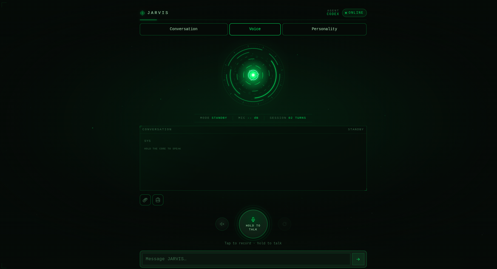
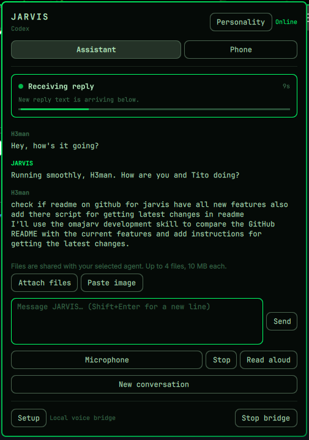
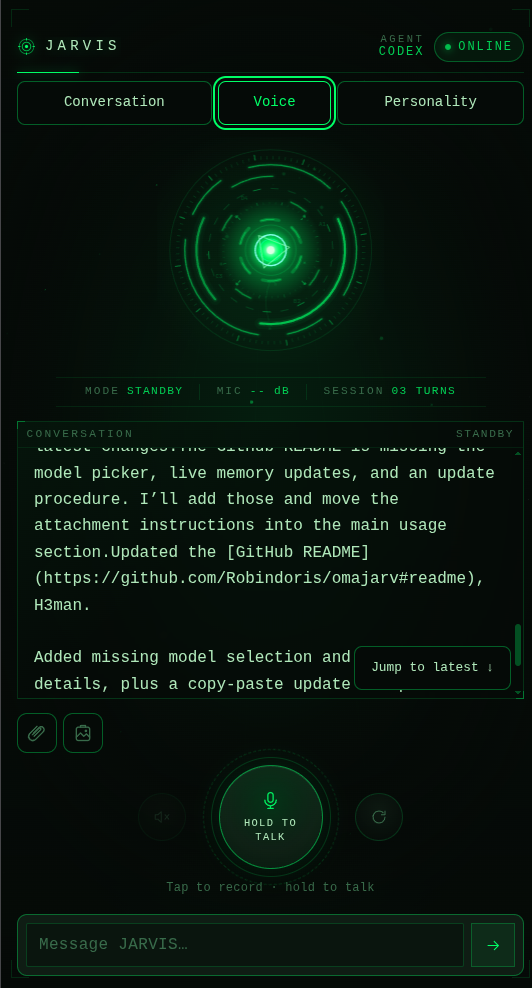

# omajarv

**Talk to your Omarchy coding agent from the bar—or from your phone.**

omajarv adds a J.A.R.V.I.S. reactor to the Omarchy bar. Open it, type a request or
record your voice, and get a reply from your default coding agent. Scan the QR in
the **Phone** tab to continue that same JARVIS conversation away from the desktop.

Whisper turns speech into text on your computer. Piper generates speech there;
replies play on the device you are using.
The coding agent handles the request using its own tools, permissions and provider.
**Local speech does not mean a local coding model.**

## Screenshots

### Voice interface



### Desktop assistant and phone

<p>
  
  
</p>

## Get it running

You need Omarchy Quattro, Node.js **22 or newer**, `curl`, `jq` and `openssl`, plus
an installed, signed-in coding agent selected in Omarchy. Codex, Claude Code,
OpenCode and Hermes support private stdin prompts and conversation sessions.
OpenCode must support `run --standalone --format json`; Hermes must support
`hermes acp` with session loading and cancellation. Upgrade older CLIs if these options
are unavailable. Other agents remain disabled until their private transport is
verified. You can override the Omarchy default with `"agent": "opencode"` (or
`"hermes"`, `"codex"`, `"claude"`) in the JARVIS configuration.

OpenCode retains its configured permission rules. Hermes permission requests are
denied in normal mode because JARVIS has no interactive approval dialog. Explicit
`"agentFullAccess": true` enables OpenCode auto-approval and lets JARVIS approve
Hermes permission requests for that turn. Only enable it for trusted requests.

```bash
git clone https://github.com/Robindoris/omajarv.git ~/.local/share/omajarv
cd ~/.local/share/omajarv
bash install.sh
```

Keep this clone: the installer points the `jarvis` command and user service at it.
It also installs the bar plugin under `~/.config/omarchy/plugins/h3man.jarvis/`.
Global coding-agent instructions are optional. Ordinary setup, marketplace setup,
and native onboarding do not install or refresh them. To explicitly install or
refresh the bundled development skill, run:

```bash
bash install.sh --install-agent-skill --no-packages --no-models --no-service --no-plugin
```

This flag copies plugin-authored instructions to `~/.agents/skills/omajarv-dev/`,
where other coding tools can discover them outside JARVIS and this project.
Each refresh requires the flag; differing existing content is backed up under
`~/.local/state/omarchy-jarvis/skill-backups/`. Uninstall retains the skill and its
backups; remove `~/.agents/skills/omajarv-dev/` manually when no longer wanted.
Agents may need a skill reload or a new session to discover it.
The plugin ID remains `h3man.jarvis`; the command is `jarvis`.

The installer walks through:

1. **Dependencies.** Ask before installing missing Whisper, Piper, FFmpeg and other
   packages. Piper may need an AUR build through `yay`.
2. **Models.** Detect existing models, offer to reuse them, download verified defaults,
   or skip voice entirely. Downloads require a separate confirmation.
3. **Networking.** Offer to review desktop/private Tailscale, home LAN, or Cloudflare
   access. Keeping the default leaves the bridge on loopback, with no public tunnel.
4. **Startup.** Install `omarchy-jarvis.service` and place the reactor in the bar.

If you install the source through the Omarchy marketplace, open the reactor and
choose **Assistant → Open setup** to run the same onboarding in a terminal.

Voice is optional. Choose **Skip** for both models to start with text chat.
To revisit setup later:

```bash
jarvis setup          # packages, models and optional network review
jarvis models         # model selection only; restart the bridge after changes
jarvis setup-status   # inspect local model readiness without changing anything
jarvis restart
```

### Get the latest changes

For an existing Git clone install, run this Bash snippet from a terminal. Change
`repo` if you cloned elsewhere. It refuses to update a checkout with local edits
and uses a fast-forward pull so divergent history is left for you to resolve.

```bash
(
  set -euo pipefail
  repo="$HOME/.local/share/omajarv"
  cd "$repo"
  if [[ -n "$(git status --porcelain)" ]]; then
    echo "Local changes found. Commit or stash them before updating." >&2
    exit 1
  fi
  git pull --ff-only origin main
  bash install.sh --no-packages --no-models
  jarvis restart
  jarvis status
)
```

Rerunning the installer refreshes the launcher, user service, bar plugin and bundled
skill. This snippet skips package installation and model downloads; if a release
adds dependencies, run `jarvis setup` afterward. Your configuration, models,
personality and saved history are retained. The restart interrupts active requests
and clears temporary attachments, so finish your conversation's current request
first. For a marketplace installation, use the marketplace's update mechanism;
this snippet is for the clone you originally installed from.

### Which models?

| Component | Offered download | Approximate size |
| --- | --- | --- |
| Speech recognition | Whisper `base.en` | 148 MB |
| Spoken replies | Piper `en_US-ljspeech-medium` | 64 MB |

Setup checks the configured model paths and common Whisper/Piper directories. Reused
models stay in place. Downloaded models use pinned revisions and are checked against
expected sizes and SHA-256 hashes. Weights are **not** included in this repository.
See [model locations and upstream terms](docs/MODELS.md).

## At the desktop

Click the reactor to open **Assistant**.

- Type a request and press **Enter**, or click **Microphone** and then **Finish recording**.
- Watch the activity card for listening, transcription, agent processing, receiving
  a reply, or speech playback. It shows elapsed time and stopped/error states.
- Enable **Read aloud** for Piper playback. **Stop** interrupts the current request
  or playback; closing the panel while recording cancels microphone capture.
- **New conversation** clears JARVIS's shared transcript and remembered agent sessions.

Want a keyboard shortcut? Check for an existing binding, then add this to
`~/.config/hypr/bindings.lua`:

```lua
o.bind("SUPER + CTRL + J", "JARVIS assistant", "jarvis toggle")
```

Phone and desktop share JARVIS history, including after bridge restarts. They do
not attach to an unrelated agent conversation already running in another terminal.
Only one agent request runs at a time.

### Files and clipboard images

Use **Attach files** in desktop or phone chat, or paste an image into the message.
Desktop also offers **Paste image** and Ctrl+V; phone clipboard-button availability
depends on browser permissions, with the file picker as a fallback. Desktop needs
`zenity` for the file picker and `wl-clipboard` for clipboard access.
You can send up to four files (10 MiB each), with or without accompanying text, and
remove pending files before sending. Files are shared with your selected agent;
Codex receives raster images through its image input, while other supported agents
use their file-reading tools. File format support depends on the selected agent.
Attachments expire after 24 hours and are cleared by New conversation or restart.

### Coding agent models

With OpenCode selected, use the model picker in desktop or phone chat to choose
a provider/model or return to **Agent default**. Free variants appear first.
The choice is saved per agent. Finish or stop the current request before changing
models. Hermes uses its own default; run `hermes model` in a terminal to change it.
Codex and Claude do not expose a model picker in JARVIS.

## On your phone

Open **Phone**, choose a connection, and scan its QR with your phone camera.
Open the link in your browser and allow microphone access if you want voice input.
The computer must remain on and the JARVIS service must be running.

| Connection | When to use it | What to configure |
| --- | --- | --- |
| **Tailscale** | Private access away from home, with a stable address | Connect both devices to your tailnet, then press **Enable Tailscale tunnel**. Complete the HTTPS setup link if prompted. |
| **LAN** | Both devices are on your home network | Choose LAN in setup's network review. Accept the local HTTPS certificate in the phone browser. |
| **Cloudflare** | Access without joining a tailnet | Install `cloudflared` and explicitly choose Cloudflare in setup's network review. Cloudflare relays the traffic; the URL changes on restart. |

Tailscale uses private Serve, never public Funnel. JARVIS refuses to overwrite
another service already using the required Tailscale listener.
The protected Unix socket backend may require administrator authorization. Enable
uses existing noninteractive sudo permission when available, otherwise requests
authorization through Polkit. Only the system `/usr/bin/tailscale` command is
elevated. Cancelling leaves the tunnel disabled; press Enable again to retry.

The phone interface follows your **active Omarchy theme**: background, text,
controls, reactor and particles. Open pages refresh their colors within five
seconds while visible. Supported browsers can install the page through **Add to
Home Screen** or **Install app**. Tailscale is the convenient choice for a saved app
because its address stays stable while the machine name and tailnet stay the same.

**The QR and access link are credentials.** Anyone holding them can send requests to
your agent. Do not put a real QR in screenshots, public issues or your README.

## What leaves the computer?

Speech recognition and synthesis run locally. The plugin has no analytics or
telemetry. Your selected **coding agent can still send prompts, file contents and
tool output to its provider**, depending on that agent's configuration. Cloudflare,
when enabled, also relays phone traffic. Setup downloads contact Hugging Face/CDNs;
package installation contacts your package repositories.

New installs use loopback-only networking, disable Cloudflare, and do not enable
unrestricted agent execution. Existing configuration is preserved. Explicitly
setting `codexFullAccess` or `agentFullAccess` can give requests your Linux user's
permissions; it does not grant passwordless root. An unrestricted agent can read
secrets if asked—JARVIS cannot guarantee against that.

Read the [privacy and data-flow description](PRIVACY.md) and [security review](SECURITY.md)
before exposing the bridge or enabling full access.

## Phone sudo authorization

When an agent uses JARVIS's sudo helper during a chat, the phone opens an
**Administrator permission** dialog showing the exact arguments and working
directory. Review the command, then enter your computer password there and choose
**Authorize once**, or cancel. Never type a password into the conversation.

The phone encrypts the password for a short-lived local askpass helper. The bridge
relays ciphertext; only that helper decrypts it and writes it to sudo's private
password pipe. Passwords are not saved in settings, transcripts, agent input or
normal logs. Requests expire after two minutes, and Stop closes pending requests.
HTTPS is required; development HTTP mode disables this feature. No sudoers or
system permission changes are installed, and the agent's existing tool permissions
still apply. Already passwordless commands can run without a password dialog.

This is a separate password transport, not isolation from a hostile local agent:
a full-access agent runs as your Linux user and can inspect that user's processes
or modify local helpers. Use this only with agents and privileged commands you
trust. Agent tools must use the provided helper; commands that bypass it, or run
on another machine or in a container without access to the helper, cannot show
this phone dialog. Privileged command output still returns to the coding agent.

## Configuration and useful commands

After setup, your first conversation asks what to name the assistant, how it should
behave, and what to call you, in that order. These answers are saved locally and
shared between desktop and phone. You can type or speak your answers.

Open **Personality** in the bar panel or phone interface to edit both names and the
personality prompt later. Changes apply on the next request without restarting the
bridge. They start fresh agent sessions so previous personality instructions do
not carry over; your visible transcript is kept. New conversation clears chat
history while keeping your names and personality. If settings changed on another
device, close and reopen the editor before saving again.

You can also ask JARVIS to remember a fact or preference. It appends that memory
to your existing personality. Saved personality changes are loaded live for the
next request and appear when you reopen the editor; no restart is needed.

| Location | Contents |
| --- | --- |
| `~/.config/omarchy-jarvis/config.json` | Agent, networking, voice and model settings |
| `~/.local/state/omarchy-jarvis/` | Access token, TLS key, agent sessions, local transcript and temporary audio |
| `~/.local/state/omarchy-jarvis/personality.json` | Assistant name, personality prompt, preferred user name and first-conversation progress |
| `~/.local/share/omarchy-jarvis/models/` | Models downloaded by setup |

```bash
jarvis status          # bridge, agent and speech readiness
jarvis start           # start the user service
jarvis stop            # stop the user service
jarvis toggle          # show or hide the desktop assistant
jarvis phone           # open the Phone tab
jarvis tailscale-status
jarvis reset           # clear the shared conversation
jarvis logs            # follow service logs; review before sharing
```

`jarvis token` deliberately prints your access credential. Keep its output private.
For endpoint details, see [the API reference](docs/API.md).

## Remove it

```bash
jarvis uninstall
```

Run this **before** removing a marketplace copy. It stops and disables the user
service and removes the launcher and plugin. Generic marketplace removal alone
cannot stop a separately installed systemd service.

Models, configuration and local history are retained. Back up or explicitly delete
those JARVIS directories yourself if you also want their contents erased.

## Development

There is no JavaScript build step or npm dependency install. The bridge uses Node's
built-in modules; the native panel uses Omarchy's QML components.

```bash
node tests/onboarding.mjs
node tests/install.mjs
node tests/theme.mjs
node tests/tailscale.mjs
node tests/integration.mjs
node tests/agents.mjs        # OpenCode/Hermes transport, sessions and Stop
node tests/local-privacy.mjs
node tests/personality.mjs
node tests/attachments.mjs
node tests/agent-models.mjs
node tests/desktop-models.mjs
node tests/sudo.mjs          # encrypted password transport; no real sudo
node tests/privacy-audit.mjs # requires FFmpeg; checks privacy boundaries with fixtures
node tests/theme-browser.mjs  # requires Chromium
omarchy plugin validate .
```

The integration suite also needs OpenSSL, jq, qrencode and zbarimg.
Tests use temporary homes and fake agents. They do not download model weights or
change your JARVIS conversation. The browser test checks a theme change on an open
phone-sized page.

To prepare an allowlisted source package with checksums:

```bash
node scripts/build-release.mjs /absolute/path/to/empty/output
```

The builder excludes credentials, configuration, conversations, recordings, logs
and model weights, and rejects symlinks and recognizable credential patterns.
See the [publication review](docs/RELEASE-REVIEW.md) for the tested boundaries.

## License

[MIT](LICENSE) for omajarv source. Speech runtimes, coding agents and downloaded
models retain their own terms; this repository does not redistribute model weights.

### JARVIS 2.0 dashboard development

The bridge now serves a responsive dashboard with a Three.js core, live voice
activity, and a vertical sidebar with Conversation, Voice, Personality and Kanban
pages. The sidebar collapses behind the panel button on smaller screens. Saved
conversations appear below navigation; New conversation archives the active chat. Tasks persist privately on the bridge
and refresh across visible board views every two seconds. Add, edit, move or delete
tasks, or choose **Run task** to queue work with the shared JARVIS agent.

The dashboard uses React, Tailwind CSS and locally owned shadcn/ui Button
and Radix Sheet components in `frontend/src/components/ui`. Existing authenticated
voice, streaming chat, attachments, personality and encrypted sudo flows remain
in `server/public/jarvis.js`. No runtime CDN or external asset requests are needed.

To rebuild after editing `frontend/src/`, run `npm ci` then
`npm run build:frontend`. Commit the generated `server/public/dashboard.js` and
`dashboard.css` with the sources; installed bridges need no npm install.
Run `node tests/kanban.mjs`, `node tests/integration.mjs` and
`node tests/theme-browser.mjs` for backend and mobile regression coverage.

The authenticated `GET /api/kanban` returns `{revision,tasks}`. JSON
`POST /api/kanban` accepts `{revision,action:"create",title}`,
`{revision,action:"move",id,status}` or `{revision,action:"delete",id}`.
Statuses are `todo`, `doing`, and `done`. Stale writes return HTTP 409.

JARVIS receives instructions for the local `jarvis board` tool on every agent
request. The tool supports `list`, `add TITLE`, `move ID todo|doing|done`, and
`delete ID`, using the authenticated bridge API over its private Unix socket. Credentials never enter the agent prompt. The agent must have
terminal tool access to use the local board tool. Explicitly queued tasks run
when the shared conversation becomes idle; unqueued tasks never start themselves.

Tailwind semantic color tokens map to the bridge’s Omarchy palette. Visible clients
refresh the palette every two seconds, including sidebar, forms and Three.js colors.

Settings → Voice setup now includes guided onboarding and a **Download missing
models** button. It reuses installed files first, otherwise fetches and verifies
the pinned English Whisper/Piper models after an explicit click. The guide shows
real download progress, missing speech binaries, and an optional microphone check.
No package installation or model download happens merely by opening Settings.

Kanban tools use the private bridge socket in both HTTPS and explicit HTTP dev
mode. Run `node tests/kanban-bridge.mjs` for the agent-tool regression and
`node tests/voice-setup.mjs` for consent/progress/retry coverage without model downloads.

The Kanban board supports notes, priorities, host-local due dates, recurring tasks,
title/notes search and filters, touch dragging and keyboard column moves. Focus a
card and press Enter to edit, ↑/↓ to navigate, or Alt+←/→ to move. On its drag grip,
Space picks up/drops, ←/→ selects a column, and Escape cancels. Mobile columns can
be swiped or selected using the column buttons; card controls use 44px touch targets.

**Run task** explicitly queues work for the selected agent. Queued, Running,
Completed, Failed and Interrupted are separate from the three board columns.
Failed/interrupted work requires a deliberate retry. The backend serializes runs
with shared chat, rejects duplicate starts and retains request IDs to safely retry
lost responses. An agent turn that exits successfully moves its task to Done.

**Back up** downloads a snapshot; **Saved backups** offers the last 20 private
pre-change snapshots. Restore previews the backup and requires confirmation. It
preserves a recovery snapshot and never restarts unfinished restored work.
Recurring completion creates one new Next up occurrence; it does not run it.
The web app now declares PNG favicons and caches public install icons for offline
availability without caching private pages or API responses.


### Optional IP camera microphone

In sidebar **Settings → IP camera and optional microphone**, follow the guide to
save an RTSP camera on the computer’s trusted LAN. Enable RTSP and audio in the
camera’s app first. Test video and camera audio independently, then select
**Camera microphone** for voice recording on a computer with no microphone.
Voice capture starts only when you press Record; stream tests start explicitly. It does not use the browser’s
microphone permission. Device microphone remains the default. Whisper is still
required for transcription. Use **Forget camera** to remove its private settings.
Video is a preview only and is never sent to the AI. Supported cameras expose RTSP
on a private IPv4 address; cloud-only and HTTP-only cameras are not supported.

See [camera setup and troubleshooting](docs/IP-CAMERA.md) for requirements and limitations.

Voice opens by default on fresh page loads when both speech recognition and speech
playback report ready. Missing models or runtimes keep text as the default. Setup
completion updates the default without closing Settings. Explicit chat/voice choices
remain selected for that page session; readiness checks never open a microphone or
start recording.
